# Auditoría UI/UX y accesibilidad (T24)

Auditoría del frontend de HanZi Mentor antes y después del rediseño
(PR #26), con medición automática (axe-core, WCAG 2.1 AA), medición de
contraste sobre píxeles y revisión manual del teclado. Las fallas pequeñas
se corrigieron en la rama `feature/auditoria-ux`; las grandes quedan como
pendientes al final de esta página.

Fecha de la medición: 28/10/2026.

| Versión | Qué es | Commit |
|---------|--------|--------|
| **Antes** | Frontend previo al rediseño (base del PR #26) | `debe6e7` |
| **Después del #26** | `development` con el rediseño, sin las correcciones de esta auditoría | `a6d4972` (medido en `586ed29`) |
| **Esta rama** | `feature/auditoria-ux` con las correcciones H1 a H10 y H11 parcial | `85d969e` |

---

## 1. Objetivo y alcance

Comprobar que la interfaz se puede usar con teclado, con lector de pantalla,
en móvil y en escritorio, en los dos idiomas, y documentarlo con evidencia
que se pueda repetir.

- **Páginas:** Inicio (`/`), Trazos (`/trazos`), Practicar (`/practica`),
  Progreso (`/progreso`) y Cómo funciona (`/como-funciona`). `/tutor` es un
  alias de Practicar y no se mide aparte.
- **Viewports:** 375×812 (móvil) y 1280×800 (escritorio). En escritorio la
  app se muestra como una columna centrada de 560 px, en las dos versiones.
- **Estados:**
  - **Carga:** la petición del catálogo se retrasa 4 s en Trazos.
  - **Vacío:** cada captura usa un navegador limpio, es decir, un usuario
    nuevo sin progreso.
  - **Error:** el servicio de progreso detenido (`agente_tutor` en el
    "antes", `flask_progreso` en el "después").
  - **Foco:** recorrido con Tab.
  - **Idioma:** inglés, solo en el "después"; el "antes" no tenía i18n.

## 2. Método

| Herramienta | Versión | Para qué |
|-------------|---------|----------|
| Google Chrome (`channel: 'chrome'`) | 155.0.8059.85 | Navegador de todas las mediciones |
| Playwright | 1.64.1 | Navegar, capturar y recorrer con Tab |
| axe-core / @axe-core/playwright | 4.14.0 / 4.14.0 | Reglas `wcag2a`, `wcag2aa`, `wcag21a`, `wcag21aa` |
| sharp | 0.35.5 | PNG con paleta (34 imágenes, 3,2 MB) |

Condiciones de cada captura: contexto nuevo, `serviceWorkers: 'block'`
(la PWA no sirve caché vieja), `reducedMotion: 'reduce'`,
`deviceScaleFactor: 1` y solo el área visible. Inicio y Cómo funciona
tienen además una captura `-fin` del final de la página en 375.

Las herramientas están en [`tools/auditoria-ux/`](../../tools/auditoria-ux/),
con su propio `package.json`; el frontend no gana dependencias.

- **`capturar.mjs`:** capturas, reporte axe completo en JSON y chequeos
  propios:
  - `lang` del documento, `<main>`, `h1` y pestaña activa;
  - desbordamiento horizontal;
  - controles de menos de 44 px;
  - secuencia de Tab.
- **`verificar.mjs`:** mide en píxeles el contraste de cada elemento que
  axe marca en `color-contrast`. También comprueba si la barra inferior
  tapa contenido y si el foco queda debajo de ella al recorrer con Tab.

### Por qué existe `verificar.mjs`

El fondo de paisaje se pinta con un `::before` fijo y los paneles son papel
al 75 % de opacidad. axe no ve imágenes de fondo: mezcla los paneles con el
color del `body`. A partir de 561 px ese color es `--backdrop` (`#191b1a`,
casi negro), así que axe informa fondos que no existen (por ejemplo
`#41413c`) y ratios de hasta 1,05:1 en textos que se leen bien.

`verificar.mjs` hace lo siguiente con cada elemento marcado:

1. Recorta el elemento ya pintado.
2. Toma los colores dominantes que no son el texto.
3. Calcula el ratio contra el peor de ellos.

Las cifras de contraste de esta página son esas mediciones.

### Cómo reproducirlo

Requisitos: Docker, Node 24 y Google Chrome instalado. Playwright no
descarga navegador.

```bash
cd tools/auditoria-ux
npm ci

# "Después": el stack completo de esta rama
docker compose up -d --build            # desde la raíz del repo
npm run despues                         # capturas + axe
npm run verificar:despues               # contraste en píxeles, barra y foco
docker compose stop flask_progreso      # estado de error
npm run despues:error
docker compose start flask_progreso
```

El "antes" llamaba directo a `contenido` (:8002) y `agente_tutor` (:8003),
que hoy solo se exponen dentro de Docker. Se publican de forma temporal y
solo en `127.0.0.1` con un override fuera del repo:

```yaml
# antes-override.yml (fuera del repo)
services:
  contenido:
    ports: ["127.0.0.1:8002:8002"]
  agente_tutor:
    ports: ["127.0.0.1:8003:8003"]
```

```bash
git worktree add <carpeta-fuera-del-repo>/antes debe6e7
cd <carpeta-fuera-del-repo>/antes/frontend && npm ci
printf 'VITE_TUTOR_URL=http://127.0.0.1:8003\nVITE_CONTENIDO_URL=http://127.0.0.1:8002\n' > .env.local
docker compose -f docker-compose.yml -f antes-override.yml up -d --no-deps --no-build contenido agente_tutor
npm run dev -- --port 5173 --strictPort         # dejarlo corriendo

cd tools/auditoria-ux
npm run antes && npm run verificar:antes
docker compose stop agente_tutor && npm run antes:error && docker compose start agente_tutor

# Deshacer: puertos sin publicar, sin worktree, sin Vite
docker compose up -d --no-deps --no-build contenido agente_tutor
git worktree remove <carpeta-fuera-del-repo>/antes
```

Salidas:
- Imágenes en [`img/auditoria-ux/`](img/auditoria-ux/).
- JSON en `tools/auditoria-ux/reportes/{antes,despues}/`:
  - `resumen.json` y `resumen-error.json`: cifras de axe;
  - `verificacion.json`: contraste en píxeles, barra y foco;
  - un JSON de axe completo por página.

### Limitaciones

- **No se comparan tiempos:** el "antes" corre en el servidor de desarrollo
  de Vite y el "después", en el build servido por Nginx.
- **El contraste sobre el paisaje varía con el desplazamiento.** El fondo es
  fijo, así que la zona de imagen bajo un panel cambia según la posición.
  Las correcciones se validaron contra el fondo de panel más oscuro medido
  (`#d4c4a4`).
- **Objetivos de 44 px:** es una recomendación AAA (2.5.5), no un requisito
  AA.
- **Criterios de WCAG 2.2:** el foco tapado (2.4.11) no está en WCAG 2.1;
  se corrigió igual porque afecta el uso con teclado.
- **Lector de pantalla:** no se probó con uno real. Los nombres accesibles
  se comprobaron con el árbol de accesibilidad de Chrome
  (`ariaSnapshot` de Playwright).

---

## 3. Checklist

Cada celda empieza por el estado (Cumple, Parcial o No cumple), seguido de la observación.

| Punto | Cómo se midió | Antes (`debe6e7`) | Después del #26 | Esta rama | Evidencia |
|-------|---------------|-------------------|-----------------|-----------|-----------|
| Navegación | axe, chequeo de `<main>`, `h1` y `aria-current`, secuencia de Tab | Parcial: barra con `aria-current` y un `h1` por página; sin `<main>` | Parcial: igual; sin `<main>` | Cumple: `header`, `main` y `nav` en todas las páginas | H8 |
| Estados vacíos | Usuario nuevo en Inicio, Progreso y Practicar | Parcial: mensajes claros, pero "50 % de acierto" sin intentos | Parcial: igual | Parcial: igual (pendiente H12) | H12 |
| Carga | Catálogo retrasado 4 s; `role="status"` o `aria-live` | Parcial: "Cargando…" visible, no anunciado | Cumple: `role="status"` | Cumple | [carga](#carga) |
| Errores | Servicio de progreso detenido | No cumple: mensaje técnico, sin `role="alert"` ni reintento | Parcial: `role="alert"` y mensaje traducido, sin reintento | Cumple: además, botón "Actualizar" | H9 |
| Contraste | axe + `verificar.mjs` | No cumple: 37 elementos, 2,64–4,20:1 | No cumple: 78 elementos, 1,77–4,50:1 | Parcial: 5 elementos `--cinnabar` a 4,28:1, solo en 1280 | H1, H5–H7, H11 |
| Foco | Tab hasta 40 pasos; anillo visible y su contraste; foco bajo la barra | Parcial: anillo del navegador; 20 focos tapados por la barra | No cumple: anillo ocre de 2,16–2,53:1; 17 focos tapados | Cumple: anillo jade de 5,32–7,23:1; 0 tapados | H4, H10 |
| Teclado (Enter y Espacio) | Tipo de elemento de cada parada de Tab | Cumple: `a` y `button` nativos | Cumple: igual | Cumple: igual | Secuencia de Tab |
| Responsive | Sin desplazamiento horizontal en 375 y 1280; zoom; objetivos de 44 px | No cumple: zoom bloqueado (`meta-viewport`); sin desplazamiento horizontal | Parcial: zoom permitido; objetivos menores de 44 px (AAA) | Parcial: igual (pendiente H14) | H14 |
| i18n | `lang` del documento, textos en español que queden en EN, desbordes | No cumple: sin i18n, textos fijos en español | Cumple: ES/EN, `lang` sincronizado, sin restos ni desbordes | Cumple: además, nombres accesibles traducidos | [idioma](#idioma) |
| Formularios y controles | axe `label`, `button-name`, `label-content-name-mismatch`; `aria-pressed` | Cumple: nombres correctos | No cumple: ES/EN y una baldosa con nombre distinto del texto visible | Cumple | H2, H3 |

La app no tiene campos de texto. Sus "formularios" son grupos de botones:
selector de idioma, modo de práctica, nivel HSK y lista de caracteres. Todos
usan `button` con `aria-pressed`.

---

## 4. Cifras

### axe (WCAG 2.1 AA)

Formato de cada celda: reglas violadas por severidad (S = serious,
M = moderate) y, entre paréntesis, elementos afectados. No hubo violaciones
critical ni minor en ninguna versión.

| Página | Ancho | Antes | Después del #26 | Esta rama |
|--------|:-----:|-------|-----------------|-----------|
| Inicio | 375 | 1 M (1) | 2 S (9) | 0 |
| Inicio | 1280 | 1 S (3) + 1 M (1) | 2 S (20) | 1 S (9) |
| Trazos | 375 | 1 M (1) | 2 S (7) | 0 |
| Trazos | 1280 | 1 S (2) + 1 M (1) | 2 S (21) | 1 S (12) |
| Practicar | 375 | 1 S (5) + 1 M (1) | 2 S (7) | 0 |
| Practicar | 1280 | 1 S (5) + 1 M (1) | 2 S (12) | 1 S (5) |
| Progreso | 375 | 1 S (5) + 1 M (1) | 2 S (11) | 0 |
| Progreso | 1280 | 1 S (5) + 1 M (1) | 2 S (27) | 1 S (14) |
| Cómo funciona | 375 | 1 S (5) + 1 M (1) | 2 S (10) | 0 |
| Cómo funciona | 1280 | 1 S (7) + 1 M (1) | 2 S (25) | 1 S (7) |
| Error (Progreso) | 375 | 1 S (4) + 1 M (1) | 2 S (6) | 0 |
| Inglés (Inicio y Progreso) | 375 | — | 2 S cada una | 0 |

Reglas:

- **Antes:** `color-contrast` (S) y `meta-viewport` (M, zoom bloqueado).
- **Después del #26:** `color-contrast` (S) y `label-content-name-mismatch`
  (S).
- **Esta rama:** solo `color-contrast` en 1280. Casi todo es la lectura
  errónea de axe explicada en la sección 2; las fallas reales son las 5
  de H11.

### Contraste medido en píxeles (`verificar.mjs`)

| | Antes | Después del #26 | Esta rama |
|---|:---:|:---:|:---:|
| Elementos que axe marca | 37 | 121 | 47 |
| Fallan medidos en píxeles | 37 | 78 | **5** |
| Fallan en 375 | 15 | 33 | **0** |
| Fallan en 1280 | 22 | 45 | **5** |
| Focos tapados por la barra inferior | 20 | 17 | **0** |
| Contenido tapado al final de la página | 0 | 0 | 0 |

---

## 5. Hallazgos

Severidad: impacto de axe o, si axe no lo mide, la que se le asignó en la
revisión manual.

| # | Severidad | Criterio WCAG | Página | Hallazgo | Estado |
|---|-----------|---------------|--------|----------|--------|
| H1 | Serious | 1.4.3 (AA) | Todas | `--ink-faint` a 2,35–2,74:1: barra inferior, ES/EN, crédito de Tatoeba, modo y niveles inactivos | Cumple |
| H2 | Serious | 2.5.3 (A) | Todas | ES/EN con nombre accesible "Español"/"English", que no contiene el texto visible | Cumple |
| H3 | Serious | 2.5.3 (A) | Inicio | Baldosa de "Palabras del día" con `aria-label` distinto del texto visible | Cumple |
| H4 | Serious | 1.4.11 (AA) | Todas | Anillo de foco ocre a 2,16–2,53:1 | Cumple |
| H5 | Serious | 1.4.3 (AA) | Inicio | Pinyin cinabrio sobre las baldosas: 2,33 (roja), 3,74 (jade), 4,06 (ocre) | Cumple |
| H6 | Serious | 1.4.3 (AA) | Inicio | Contador "/ 06" en `--ink-subtle`, 1,77–2,25:1 | Cumple |
| H7 | Serious | 1.4.3 (AA) | Cómo funciona | Nivel activo (2,55:1) y paso 03 (2,16:1) en ocre | Cumple |
| H8 | Moderate | 1.3.1, 2.4.1 (A) | Todas | Sin landmark `<main>` | Cumple |
| H9 | Moderate | 3.3.1 (A) | Progreso | En el estado de error no hay forma de reintentar | Cumple |
| H10 | Moderate | 2.4.11 (WCAG 2.2) | Inicio, Trazos | El foco queda debajo de la barra inferior fija | Cumple |
| H11 | Serious | 1.4.3 (AA) | Todas, en 1280 | Texto sobre el panel al 75 % encima del paisaje: 16 elementos a 3,92–4,50:1 | Parcial |
| H12 | Minor (UX) | — | Progreso | Un usuario nuevo ve "50 %" de tasa de acierto sin haber respondido | Pendiente |
| H13 | Minor | 2.1.1 (excepción), 2.5.1 | Trazos | El lienzo solo escucha ratón y táctil (no `pointer`) y no hay práctica sin dibujo | Pendiente |
| H14 | Recomendación AAA | 2.5.5 (AAA) | Todas | Objetivos táctiles menores de 44 px | Pendiente |

Las capturas siguientes comparan el **antes** (`debe6e7`) con **esta
rama**. Los valores del estado intermedio (después del #26) están en el
texto.

### H1, H2 y H6: barra inferior, selector de idioma y contador de Inicio

<table>
<tr><th>Antes</th><th>Esta rama</th></tr>
<tr>
<td>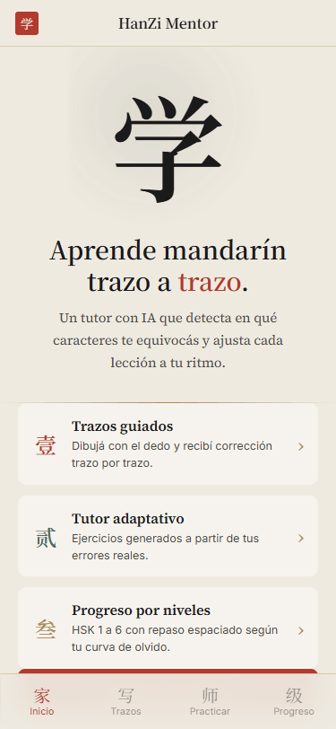</td>
<td>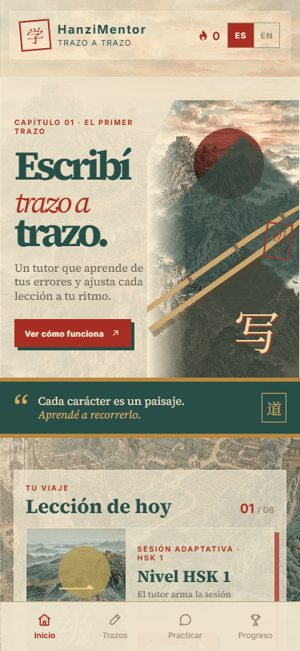</td>
</tr>
</table>

- **H1:**
  - El #26 mantuvo el gris de la barra (2,66:1 antes) y lo extendió al
    selector de idioma, el crédito de Tatoeba, el modo inactivo de
    Practicar y los niveles bloqueados (51 elementos, 2,35–2,74:1).
  - Corrección: `--ink-faint: #585143`. Mide 4,90–5,84:1 en sus usos,
    4,58:1 sobre el fondo de panel más oscuro medido y 6,22:1 sobre papel.
  - Para conservar la jerarquía se oscureció también `--ink-muted` (H11).
    El orden por luminancia relativa queda `--ink` (0,019) <
    `--ink-muted` (0,059) < `--ink-faint` (0,084).
- **H2:**
  - Antes el nombre accesible era "Español"/"English". La corrección lo
    deja como "ES, Español" / "EN, English", con la clave i18n nueva
    `language.option`.
- **H6:**
  - El contador pasa de `--ink-subtle` a `--ink-muted` (7,05:1).

### H3 y H5: baldosas de "Palabras del día"

<table>
<tr><th>Antes</th><th>Esta rama</th></tr>
<tr>
<td>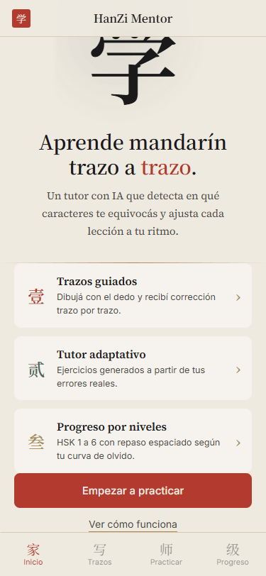</td>
<td>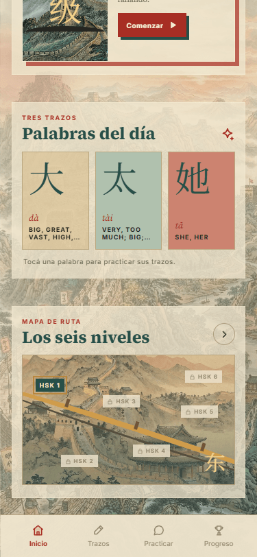</td>
</tr>
</table>

Las baldosas son nuevas del #26.

- **H3:**
  - Se quitó el `aria-label`. El nombre accesible ahora sale del texto
    visible más una acción oculta visualmente (clave
    `home.words.tileAction`).
  - Ejemplo de nombre resultante: "大 dà big, great, vast, high, deep
    Practicar sus trazos".
- **H5:**
  - El pinyin pasa de cinabrio a `--ink`.

### H4 y H10: anillo de foco y foco tapado por la barra

<table>
<tr><th>Antes</th><th>Esta rama</th></tr>
<tr>
<td>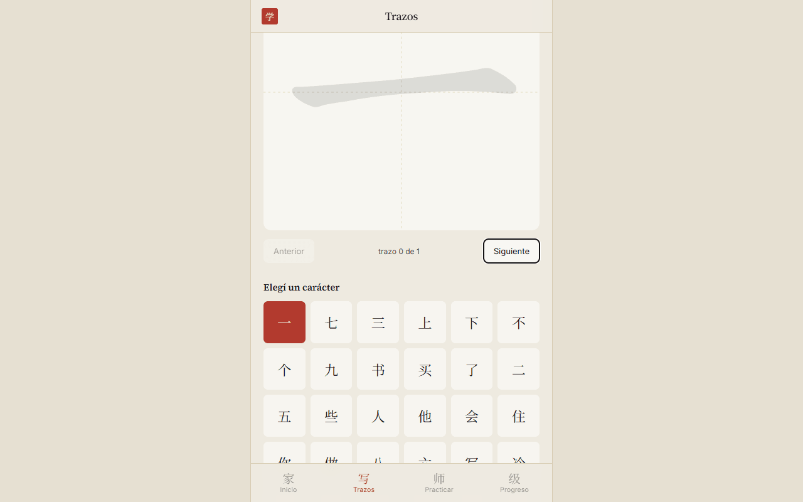</td>
<td>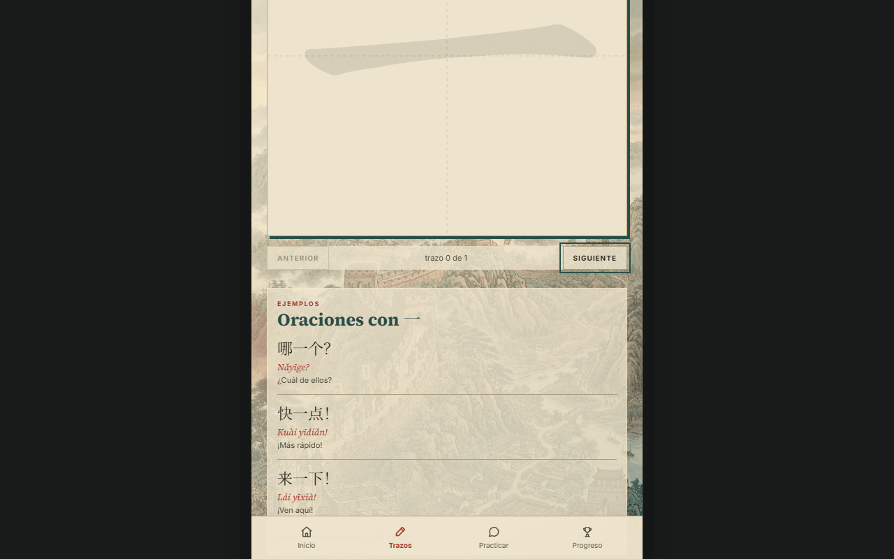</td>
</tr>
<tr>
<td>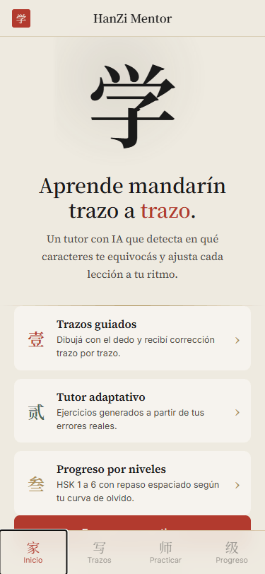</td>
<td>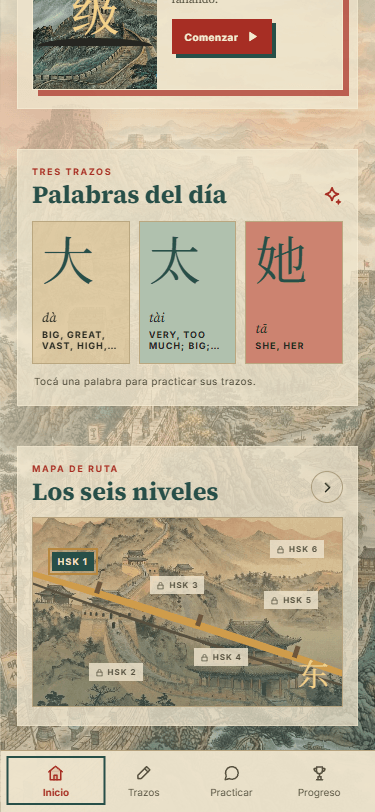</td>
</tr>
</table>

- **H4:**
  - El #26 cambió el contorno del navegador por un anillo ocre de 2 px
    (2,16–2,53:1).
  - Corrección: token `--focus-ring: var(--jade)`, aplicado a las 10
    reglas `:focus-visible`. Mide 5,32–7,23:1 contra papel y paneles.
- **H10:**
  - Al tabular, el navegador desplaza el elemento justo hasta el borde
    inferior, debajo de la barra fija. **Ya ocurría en `debe6e7`** (20
    casos) y el #26 no lo resolvió (17 casos).
  - Corrección: `html { scroll-padding-bottom: calc(var(--tabbar-h) + var(--safe-bottom)); }`.
    Quedan 0 casos.

### H7: niveles y paso 03 en Cómo funciona

<table>
<tr><th>Antes</th><th>Esta rama</th></tr>
<tr>
<td>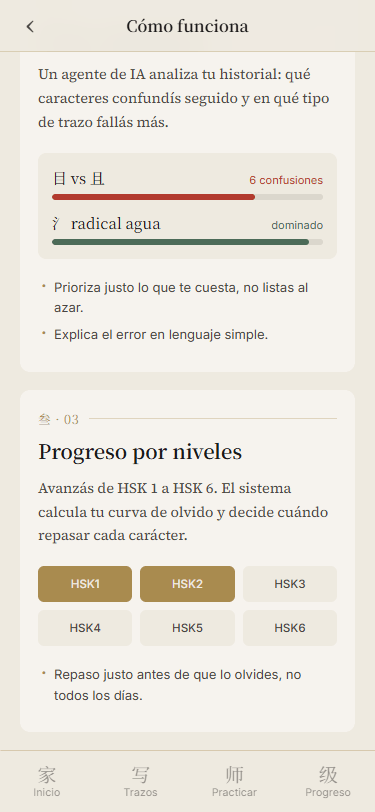</td>
<td>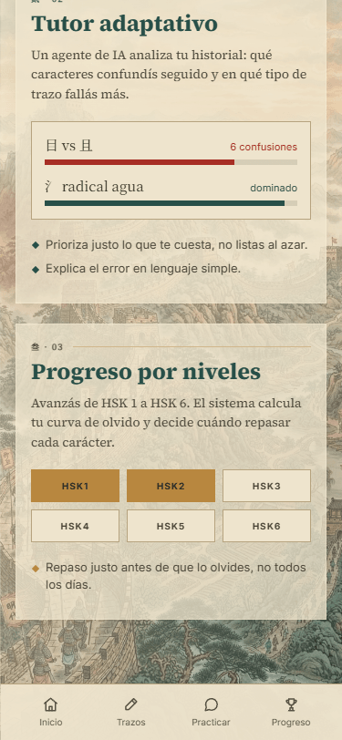</td>
</tr>
</table>

- Nivel activo: texto `--ink` sobre ocre (4,79:1).
- Paso 03: texto en `--ink-muted`. La línea del paso conserva el ocre como
  acento.

### H9: error en Progreso

<table>
<tr><th>Antes</th><th>Esta rama</th></tr>
<tr>
<td>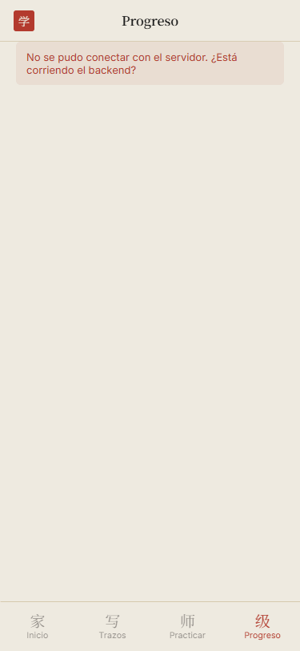</td>
<td>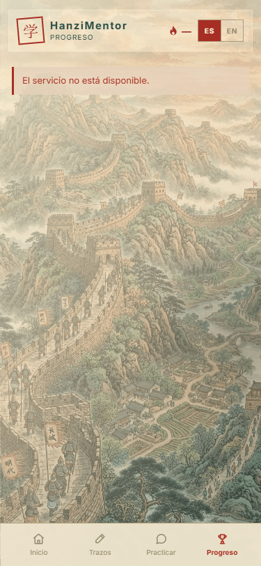</td>
</tr>
</table>

- **Antes:** "No se pudo conectar con el servidor. ¿Está corriendo el
  backend?", sin `role="alert"` y sin forma de reintentar.
- **#26:** "El servicio no está disponible." con `role="alert"`,
  traducido, pero sin acciones.
- **Esta rama:** se muestra "Actualizar" (llama al `recargar` que ya
  existía) cuando hay error, no hay datos y no está cargando.

### H8: landmark `<main>`

No tiene captura porque no cambia nada visible. Cada página convierte su
contenedor (`.hm-page` o `.home`) en `<main>`, así que el árbol queda
`header` + `main` + `nav`. Se descartó envolver `<Routes>` en `App.jsx`
porque metería el `<header>` de cada página dentro de `<main>` y perdería
su función de cabecera (banner).

### Carga

<table>
<tr><th>Antes</th><th>Esta rama</th></tr>
<tr>
<td>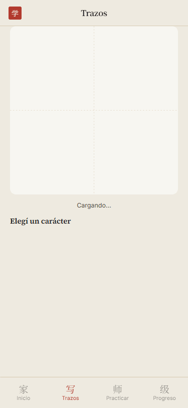</td>
<td>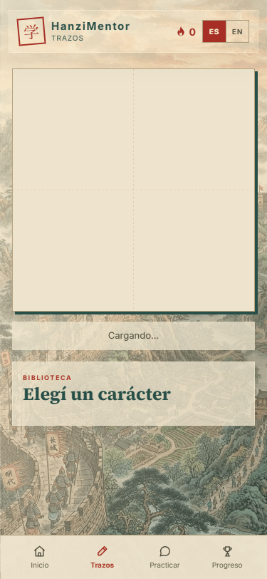</td>
</tr>
</table>

El #26 añadió `role="status"`: el "Cargando…" ahora se anuncia.

### Idioma

<table>
<tr><th>Inicio en inglés</th><th>Progreso en inglés</th></tr>
<tr>
<td>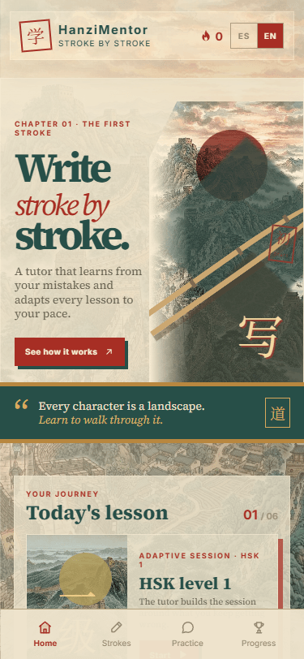</td>
<td>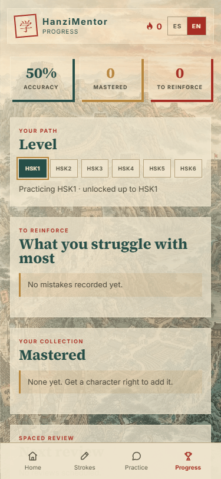</td>
</tr>
</table>

El "antes" no tenía i18n. Se documenta como hallazgo resuelto por el #26,
no como captura faltante. En esta rama, `<html lang>` pasa a `en`, no
quedan textos en español, no hay desbordes y axe da 0 violaciones.

### H11 y H12: Progreso en escritorio y en móvil

<table>
<tr><th>Antes</th><th>Esta rama</th></tr>
<tr>
<td>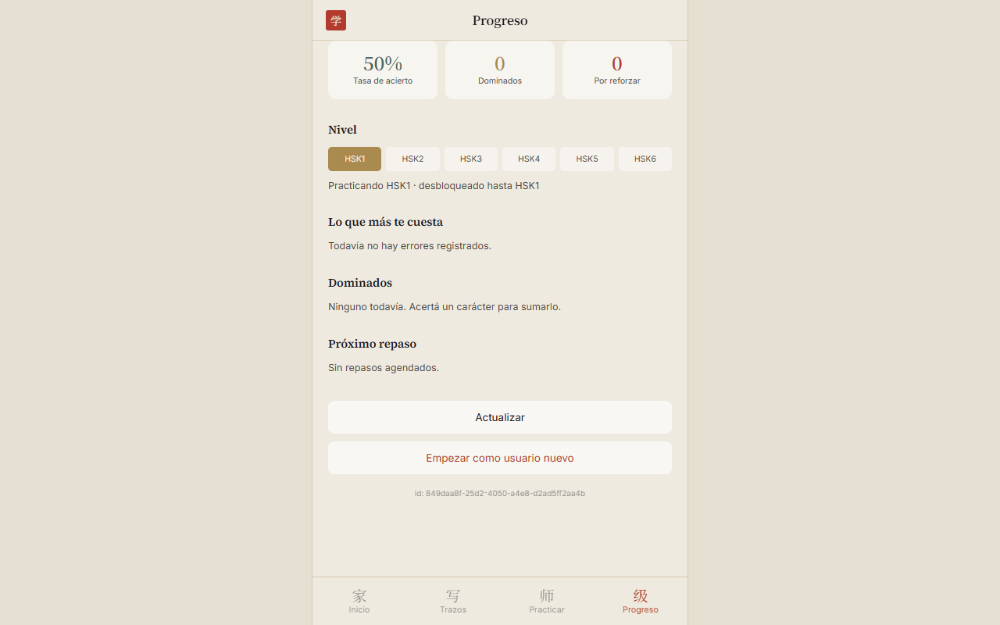</td>
<td>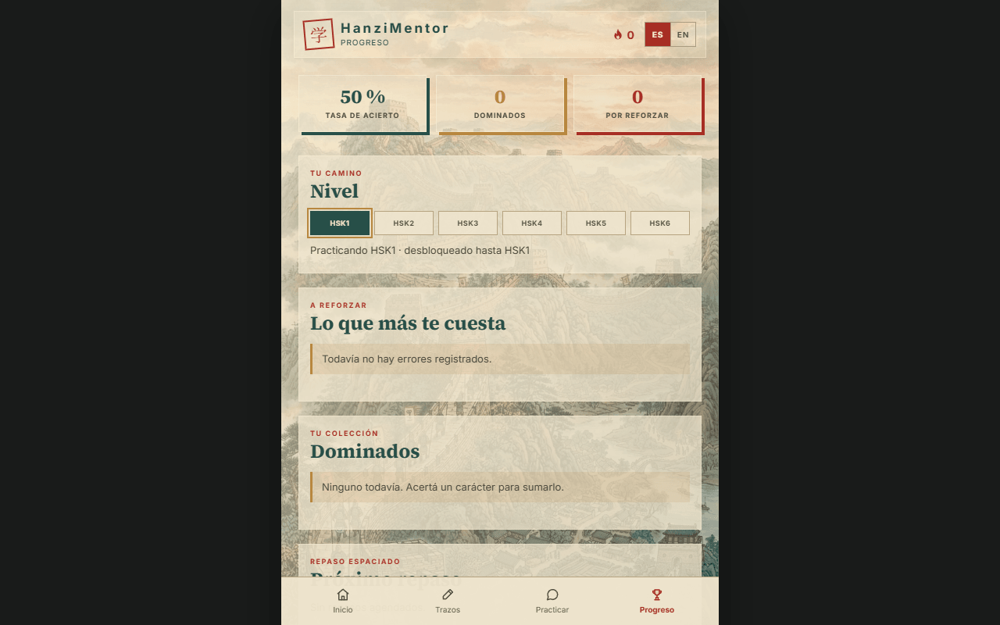</td>
</tr>
<tr>
<td>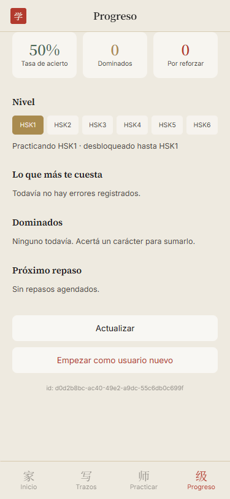</td>
<td>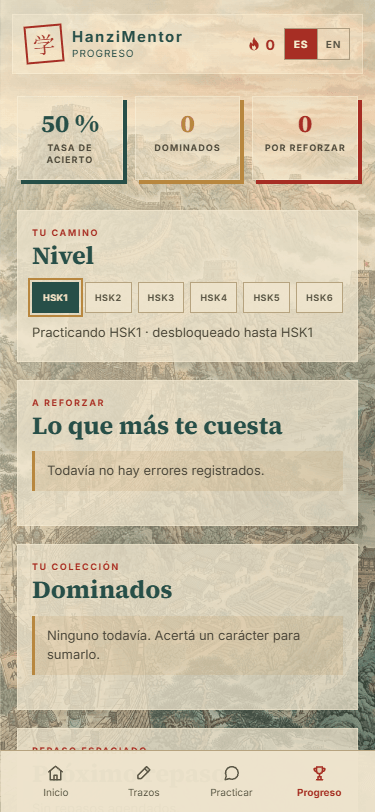</td>
</tr>
</table>

- **H11:**
  - `--ink-muted` pasa de `#625b4c` a `#4a4438`. El texto secundario sobre
    el paisaje sube de 3,92–4,50:1 a 5,62–7,73:1.
  - Quedan 5 elementos `--cinnabar` a 4,28:1 (ver pendientes).
- **H12:**
  - Las dos versiones muestran "50 %" de tasa de acierto a un usuario sin
    intentos.

### H13 y H14: Trazos

<table>
<tr><th>Antes</th><th>Esta rama</th></tr>
<tr>
<td>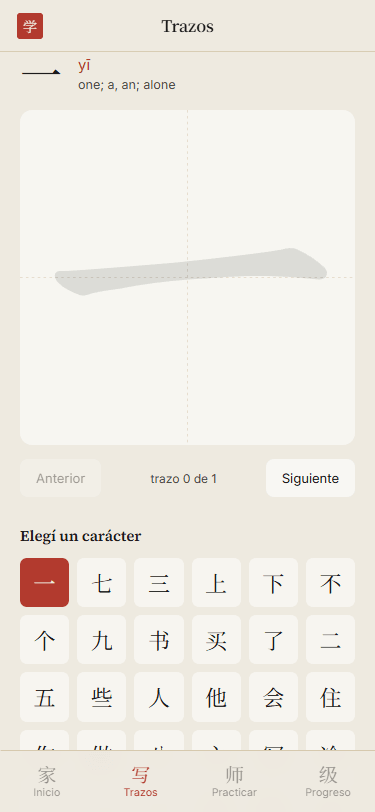</td>
<td>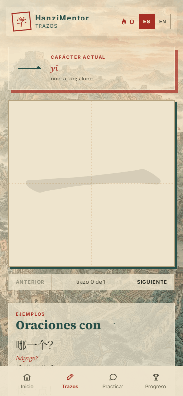</td>
</tr>
</table>

---

## 6. Lo que resolvió el PR #26 y lo que no

**Resolvió:**

- Zoom: quitó el bloqueo de `meta-viewport` (WCAG 1.4.4).
- i18n completa ES/EN, con `<html lang>` sincronizado.
- Carga anunciada con `role="status"`.
- Errores con `role="alert"` y mensaje traducido.
- Estilos `:focus-visible` propios en todos los controles.

**No resolvió o introdujo:**

- **H10:** el foco tapado por la barra ya ocurría en `debe6e7`.
- **H8 y H9:** sin `<main>` y sin reintento en el error, en las dos
  versiones.
- **Contraste (H1, H5, H6, H7 y H11):** el número de elementos que fallan
  pasó de 37 a 78 con la nueva paleta y los paneles translúcidos.
- **H2 y H3:** nombres accesibles que no contienen el texto visible.
- **H4:** el anillo de foco ocre no llega a 3:1.

Esta rama corrige todo lo anterior salvo una parte de H11.

---

## 7. Pendientes

Ninguno está asignado todavía.

| # | Qué falta | Propuesta | Por qué no se corrigió aquí |
|---|-----------|-----------|-----------------------------|
| H11 | 5 textos `--cinnabar` a 4,28:1, solo en 1280, sobre el panel al 75 % encima del paisaje: títulos pequeños de "Mapa de ruta" (Inicio) y "Repaso espaciado" (Progreso), pinyin de dos ejemplos (Trazos) y "Empezar como usuario nuevo" (Progreso) | Un cinabrio más oscuro solo para texto, o subir la opacidad de `--panel-bg` | Cambia la identidad visual: requiere el visto bueno de diseño |
| H12 | "50 %" de tasa de acierto para un usuario sin intentos | Mostrar "—" cuando no hay intentos | El 0,5 sale del valor por defecto del servicio de progreso; hay que revisar el contrato de la API |
| H13 | El lienzo de Trazos solo escucha ratón y táctil, y no hay práctica sin dibujo. "Anterior"/"Siguiente" ya recorren el orden de trazos con teclado | Eventos `pointer` (lápiz) y un modo de práctica sin dibujo | Cambia la lógica de la pantalla |
| H14 | Objetivos menores de 44 px: ES/EN 32×30, botón del mapa 32×32, "Anterior"/"Siguiente" 34 px de alto, barra inferior 37 px, "Volver" 38 px, crédito de Tatoeba 11 px | Ajustar tamaños mínimos | Recomendación AAA, no exigida por AA |

---

## 8. Resto de capturas base

<table>
<tr><th>Antes</th><th>Esta rama</th></tr>
<tr>
<td>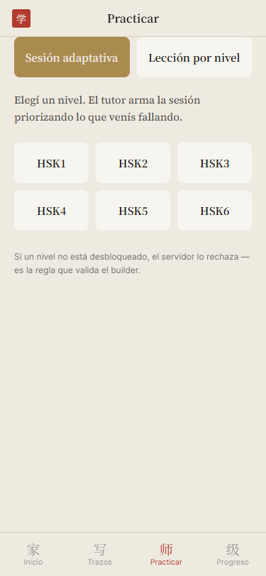</td>
<td>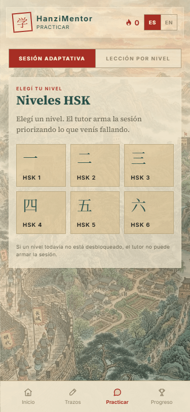</td>
</tr>
<tr>
<td>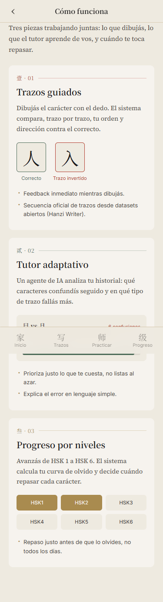</td>
<td>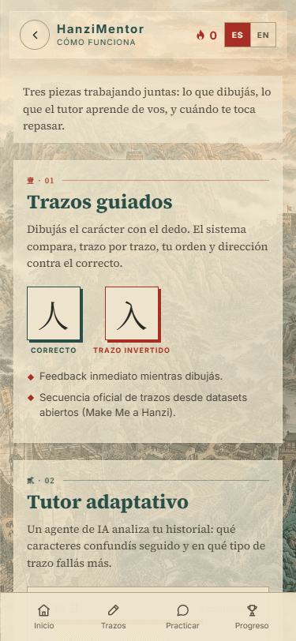</td>
</tr>
<tr>
<td>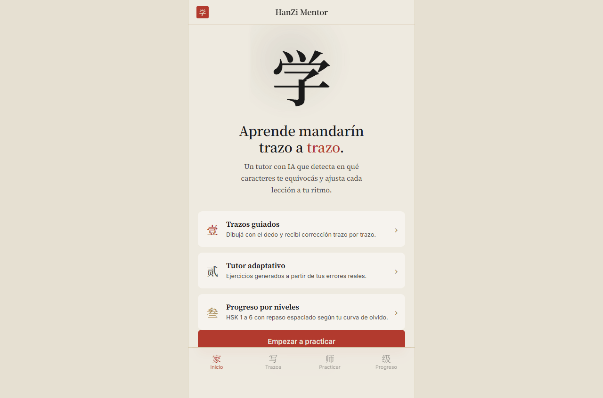</td>
<td>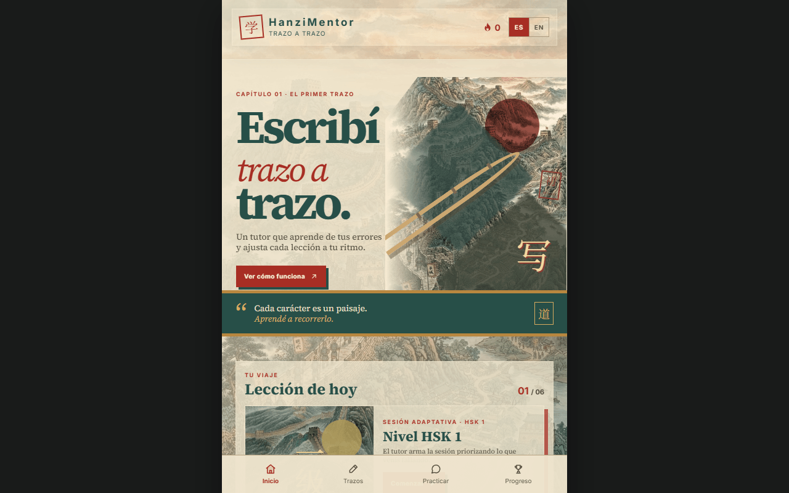</td>
</tr>
<tr>
<td>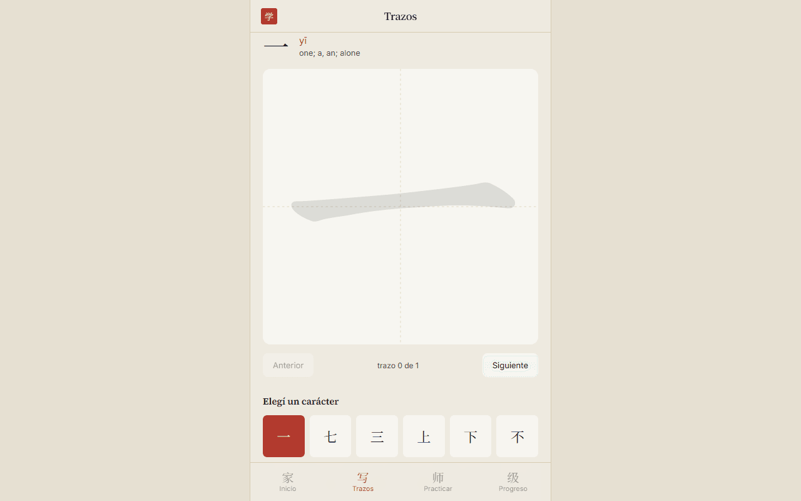</td>
<td>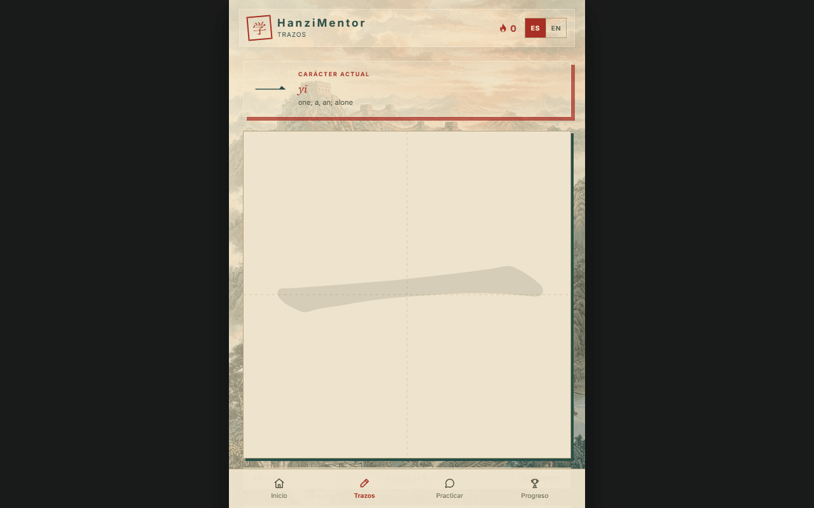</td>
</tr>
<tr>
<td>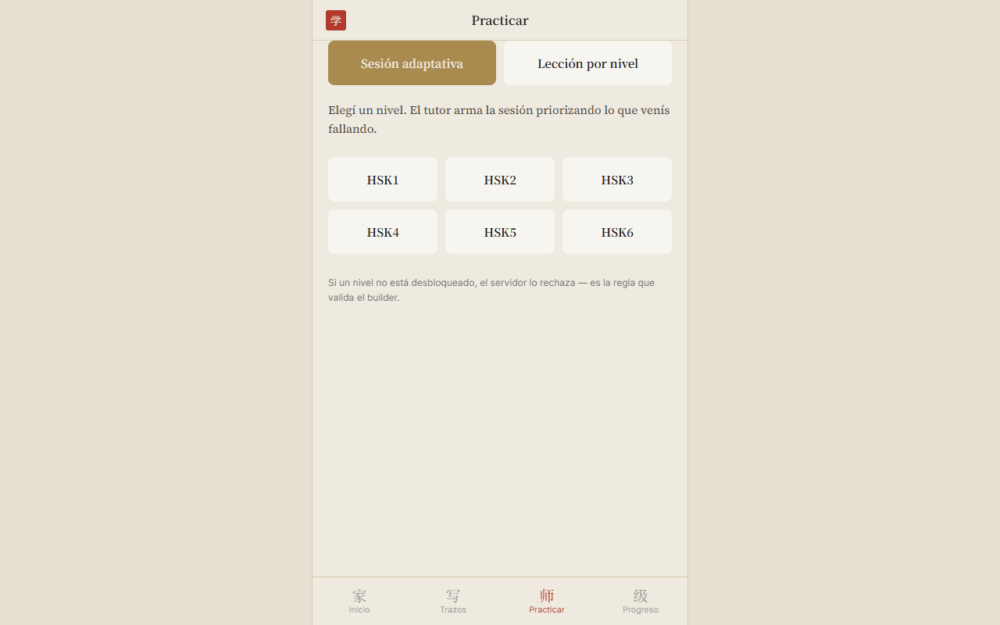</td>
<td>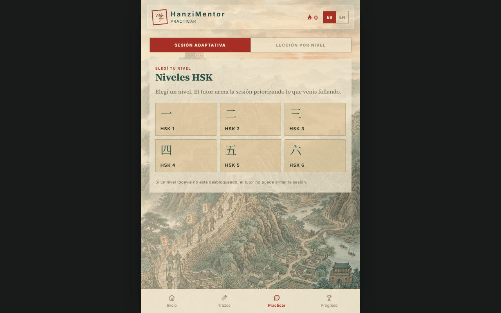</td>
</tr>
<tr>
<td>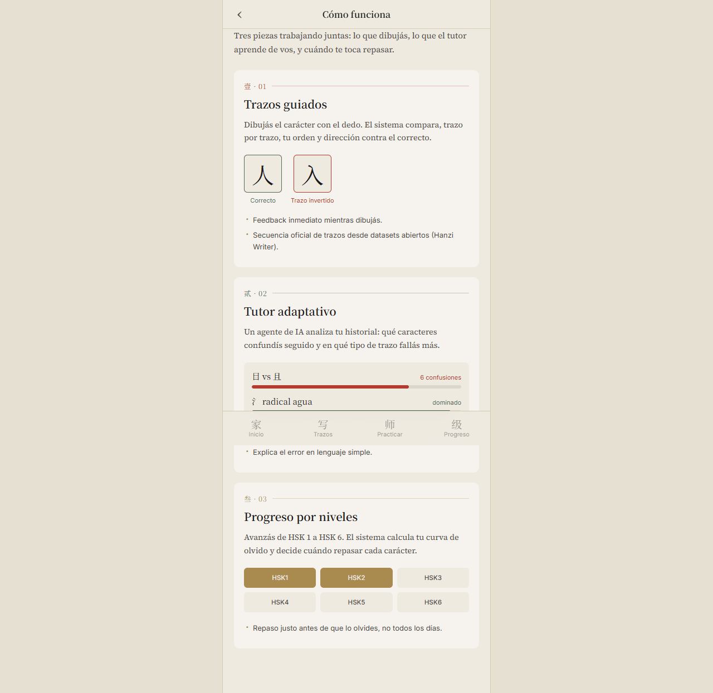</td>
<td>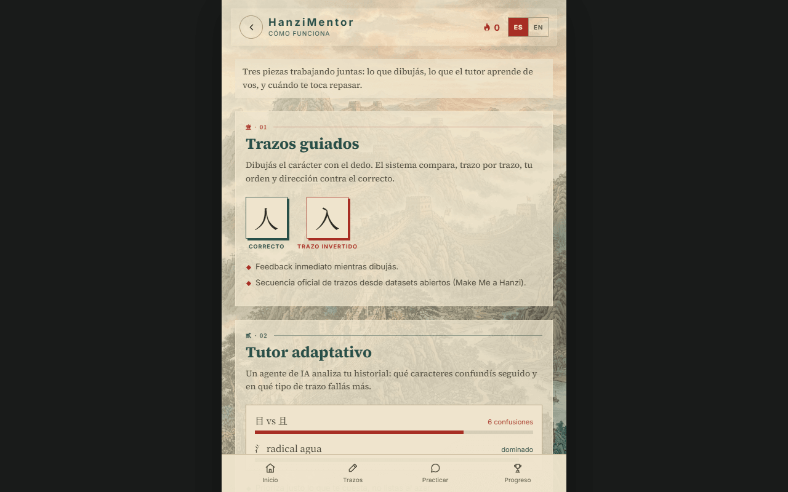</td>
</tr>
</table>

---

## 9. Commits

| Commit | Contenido |
|--------|-----------|
| `782f51f` | Herramienta de auditoría y capturas del "antes" |
| `586ed29` | Capturas del área visible y `verificar.mjs` |
| `85d969e` | Correcciones H1 a H10 y H11 parcial |
