# Entrega 2 — Migración a Microservicios, Integración y Resiliencia
 
Documentación de la Entrega 2 de HanZi Mentor: el paso del monolito Django a
un ecosistema híbrido de microservicios Flask detrás de Nginx, desplegado en
AWS Academy, con integración con un equipo aliado y una API de terceros,
tareas asíncronas e internacionalización.
 
> **Estado de esta página (11/11/2026):** incluye las correcciones de la
> Entrega 1, el bono de excelencia, la auditoría de UX y accesibilidad, la
> arquitectura con sus diagramas, el despliegue en AWS con su evidencia, la
> API de terceros, las tareas asíncronas y el servicio para el equipo aliado.
> Solo falta el consumo del servicio del equipo aliado desde HanZi Mentor.
 
---
 
## 1. Correcciones de la Entrega 1
 
La sustentación de la Entrega 1 no generó correcciones: el profesor no
notificó observaciones sobre el código, la arquitectura ni la documentación
entregada. Por eso no hay ajustes pendientes, y la condición de la rúbrica
(implementar el 100 % de las correcciones de la Entrega 1 para que esta
entrega sea revisada) se cumple sin cambios.
 
| Observación del profesor | Estado | Evidencia |
|--------------------------|--------|-----------|
| Ninguna en la sustentación de la Entrega 1 | No aplica | — |
 
Si el profesor notifica alguna corrección después, se agregará a esta tabla
con el commit o el Pull Request que la resuelve.
 
---
 
## 2. Bono de excelencia: más del 70 % migrado a microservicios
 
El enunciado exime del Parcial 02 a los equipos que migren más del 70 % de
sus servicios y lógica de negocio a microservicios funcionales e
independientes. HanZi Mentor migró a Flask **todos los endpoints de negocio
del monolito**: el 100 % de los módulos existentes y el 92 % si se cuentan
también los módulos nuevos de esta entrega.
 
### Cómo se mide
 
Cada módulo pesa tanto como **endpoints de negocio** tenía en el monolito
(inventario del 23/10/2026). Un módulo cuenta como migrado solo si cumple
todo esto:
 
- Servicio Flask propio, con su Dockerfile.
- Base de datos propia si guarda estado (un PostgreSQL compartido con una
  base por servicio: `db_catalogo`, `db_progreso`, `db_sesiones` y
  `db_suscripciones`). Si no guarda estado, sin base.
- `GET /health`, errores en JSON y pruebas con pytest.
- Ningún `import django`: la lógica se copió y se adaptó, no se importa.
- Ruta `/api/v2/...` publicada en Nginx.
- Al menos un consumidor real: el frontend u otro servicio.
### Módulos
 
| Módulo | Origen (Django) | Microservicio | Rutas v2 | Peso | Estado | Evidencia | Lo consume |
|--------|-----------------|---------------|----------|:----:|--------|-----------|------------|
| Validación de trazos | `contenido` | `trazos-flask` | `POST /api/v2/trazos/validar/` | 1 | Migrado | PR #20 (`3eef230`) | `evaluacion-flask` |
| Catálogo de caracteres | `contenido` | `catalogo-flask` | `GET /api/v2/caracteres/`, `GET /api/v2/caracteres/<hanzi>/` | 2 | Migrado | PR #25 (`debe6e7`), integrado en PR #30 (`dd82852`) | Frontend, `sesiones-flask`, `evaluacion-flask`, `agente-tutor` |
| Lecciones | `contenido` | `catalogo-flask` | `POST /api/v2/lecciones/generar/`, `GET /api/v2/lecciones/<id>/` | 2 | Migrado | PR #25 (`debe6e7`), integrado en PR #30 (`dd82852`) | Frontend |
| Progreso y repaso espaciado | `agente-tutor` | `progreso-flask` | `GET /api/v2/progreso/<usuario>/` | 1 | Migrado | PR #28 (`f393bb6`), en el gateway con PR #31 (`4851679`) | Frontend, `sesiones-flask` |
| Sesiones adaptativas y respuestas | `agente-tutor` | `sesiones-flask` | `POST /api/v2/sesiones/`, `GET /api/v2/sesiones/<id>/`, `POST /api/v2/ejercicios/<id>/responder/` | 2 | Migrado | PR #29 (`771eb01`), en el gateway con PR #31 (`4851679`) | Frontend |
| Evaluación de ejercicios | `agente-tutor` | `evaluacion-flask` | `POST /api/v2/evaluacion/` | 1 | Migrado | PR #32 (`6ac6664`), consumo en PR #35 (`728db41`) | Frontend |
| Agente tutor (LangGraph) | `agente-tutor` | — | — | 0 | Permanece en Django | — | — |
| Usuarios | `usuarios` | — | — | 0 | Permanece en Django | — | — |
| Ejemplos de oraciones (API de terceros) | Nuevo | `ejemplos-flask` | `GET /api/v2/ejemplos/<hanzi>/` | 1 | Migrado | PR #27 (`f9ebcdc`), integrado en PR #30 (`dd82852`), consumo en PR #37 (`2d58af2`) | Frontend (pantalla de Trazos) |
| Servicio para el equipo aliado | Nuevo | `catalogo-flask` | `GET /api/v2/publico/resumen/` | 1 | En progreso | PR #38 | Pendiente: equipo aliado |
| Reportes y notificaciones | Nuevo | `flask_reportes` + worker de Celery | `/api/v2/reportes/` | 1 | Migrado | PR #42 (`f0b21cf`), consumo en PR #46 (`7c4b021`) | Frontend (Progreso) |
| Suscripciones Free y Premium (RF-USR-01) | Nuevo | `suscripciones-flask` | `/api/v2/suscripciones/` (planes, consulta, activar, renovar, cancelar, pagos) | 1 | Migrado | PR #55 | Frontend (Practicar y Progreso) |
 
Los dos módulos con peso 0 no tienen endpoints de negocio propios:
 
- **Agente tutor**: es el motor que arma las sesiones. Su versión
  determinista (`MOCK`) se portó dentro de `sesiones-flask` (`motores.py`);
  la versión con LangGraph, que llama a un modelo de IA, sigue en
  `agente-tutor` y solo la usa la ruta v1.
- **Usuarios**: el servicio solo expone el panel `admin/` de Django.
### Resultado
 
| Cálculo | Peso migrado | Peso total | Porcentaje |
|---------|:------------:|:----------:|:----------:|
| Solo los módulos que existían en el monolito | 9 | 9 | **100 %** |
| Todos los módulos, incluidos los nuevos de esta entrega | 12 | 13 | **92 %** |
 
Los dos cálculos superan la meta del 70 %. Cuando el equipo aliado consuma
el servicio público (T14), el segundo sube a 100 %.
 
### Coexistencia con el monolito (Strangler Pattern)
 
El frontend y los servicios ya usan solo las rutas `/api/v2/`. Las rutas
`/api/v1/` de `contenido` y `agente-tutor` siguen publicadas en Nginx como
respaldo, como pide el patrón: si un servicio nuevo falla, v1 todavía
responde. Se retirarán cuando se apaguen esos servicios Django.
 
### Verificación
 
Verificado el 11/11/2026 en la instancia de AWS, sobre `main` (commit
`e3425c3`). El detalle y las capturas están en
[Despliegue en AWS](#despliegue-en-aws).
 
- `docker compose up -d --build` levanta los 15 contenedores y todos los
  que tienen healthcheck quedan `healthy`.
- Pruebas con pytest (Django con su runner de tests), todas pasan:
| Servicio | Tests |
|----------|------:|
| catalogo-flask | 117 |
| progreso-flask | 248 |
| sesiones-flask | 250 |
| evaluacion-flask | 247 |
| trazos-flask | 55 |
| ejemplos-flask | 46 (+1 que se salta: la prueba en vivo contra Tatoeba) |
| reportes-flask | 75 |
| suscripciones-flask | 84 |
| flask-base | 19 |
| contenido | 39 |
| agente-tutor | 53 |
| **Total** | **1233** |
 
- Ninguno de los ocho servicios Flask importa Django.
- En AWS, `GET /api/v1/caracteres/` responde 200 con `DJANGO_DEBUG=0` (el
  respaldo v1 sigue activo), el adaptador de Tatoeba devuelve oraciones y
  `GET /api/v2/publico/resumen/` responde
  ([`infra.txt`](https://github.com/jalvarez01/HanZi-Mentor/blob/main/tools/auditoria-ux/reportes/despliegue/infra.txt)).
La primera verificación se hizo el 26/10/2026 sobre `development` (commit
`728db41`), en local con Docker. Cada ruta v2 respondió a través de Nginx,
en un flujo real:
 
| Petición por Nginx | Respuesta |
|--------------------|-----------|
| `GET /api/v2/caracteres/?nivel=1&limite=3` | 200, 一 七 三 |
| `GET /api/v2/caracteres/人/` | 200, con sus 2 trazos |
| `POST /api/v2/lecciones/generar/` y `GET /api/v2/lecciones/<id>/` | 201 y 200, 3 ejercicios |
| `POST /api/v2/trazos/validar/` | 200, con el veredicto del trazo |
| `GET /api/v2/ejemplos/学/` | 200, oraciones de Tatoeba |
| `POST /api/v2/sesiones/` y `GET /api/v2/sesiones/<id>/` | 201 y 200, sesión activa con 4 ejercicios |
| `POST /api/v2/ejercicios/<id>/responder/` | 200; `progreso-flask` actualiza la tasa de acierto (de 0.5 a 0.55) |
| `POST /api/v2/evaluacion/` (pinyin) | 200, `acerto: true` |
| `GET /api/v2/caracteres/?limite=abc` con `Accept-Language: en` | 400 en JSON, mensaje en inglés |
| `GET /api/v1/caracteres/` | 200, el respaldo v1 sigue activo |
 
Para repetirlo:
 
```bash
docker compose up -d --build
docker compose ps
curl "http://localhost/api/v2/caracteres/?nivel=1&limite=3"
curl -X POST http://localhost/api/v2/sesiones/ -H "Content-Type: application/json" \
  -d '{"usuario_id": "3fa85f64-5717-4562-b3fc-2c963f66afa6", "nivel_hsk": 1, "duracion_min": 10}'
docker compose logs nginx   # cada línea muestra a qué servicio fue la petición
```
 
---
 
## 3. Resiliencia y UX
 
### Auditoría de UX y accesibilidad (T24)
 
El frontend se auditó antes y después del rediseño (PR #26), con
Playwright, axe-core (WCAG 2.1 AA) y una medición propia del contraste
sobre píxeles, en las cinco páginas, en 375 y 1280 px, y en los estados de
carga, vacío, error, foco e idioma. Detalle, capturas lado a lado y cómo
reproducirlo: **[Auditoría UX](Auditoria-UX.md)**.
 
| | Antes del #26 | Después del #26 | Con las correcciones |
|---|:---:|:---:|:---:|
| Páginas con violaciones axe en 375 px | 5 de 5 | 5 de 5 | **0 de 5** |
| Textos con contraste insuficiente (medido en píxeles) | 37 | 78 | **5** (solo en 1280) |
| Focos tapados por la barra inferior | 20 | 17 | **0** |
 
Se corrigieron 10 hallazgos (H1 a H10) y uno en parte (H11). Quedan
cuatro pendientes documentados (H11 a H14).
 
---
 
## 4. Arquitectura
 
Los diagramas están en [Mermaid](https://mermaid.js.org/): son texto dentro
de esta página y GitHub los dibuja, así que se actualizan con el código en
el mismo Pull Request.
 
### Antes y después del Strangler Pattern
 
En la Entrega 1, el frontend llamaba directamente a tres proyectos Django,
cada uno en su puerto:
 
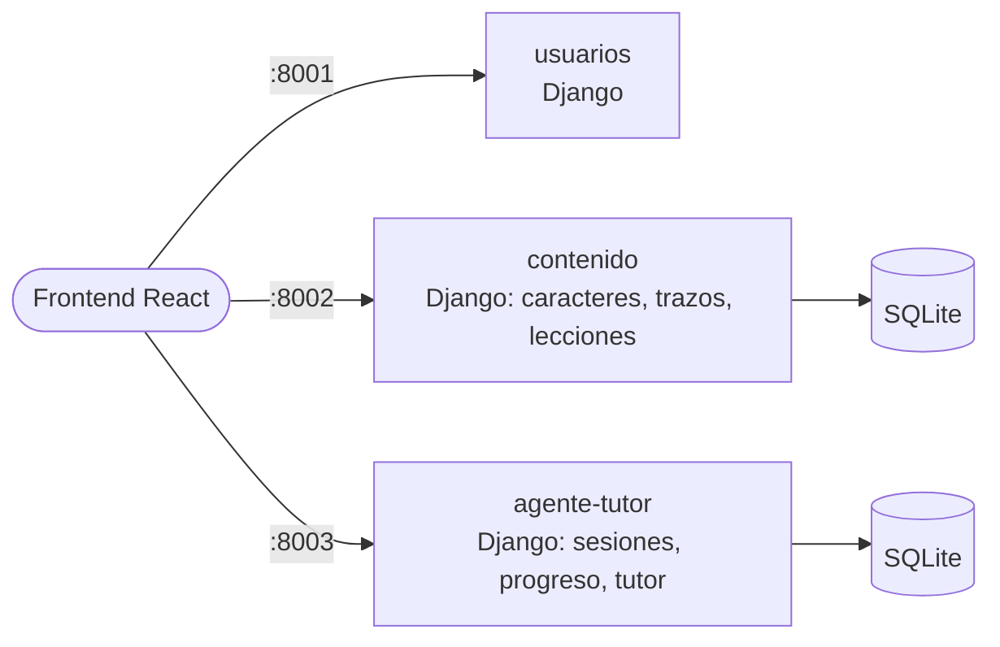
 
En la Entrega 2, todo entra por Nginx. Las rutas `/api/v2/` van a los
microservicios Flask, que son los que usa la aplicación; las `/api/v1/`
siguen llegando a Django como respaldo:
 
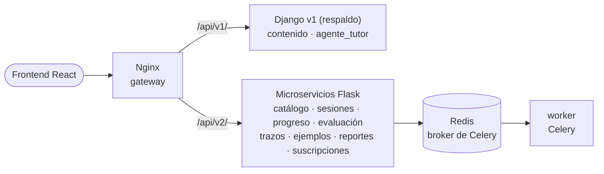
 
### Contenedores
 
Las 15 piezas que levanta `docker-compose.yml` y cómo se comunican. Solo
Nginx publica un puerto; el resto solo es accesible dentro de la red de
Docker.
 
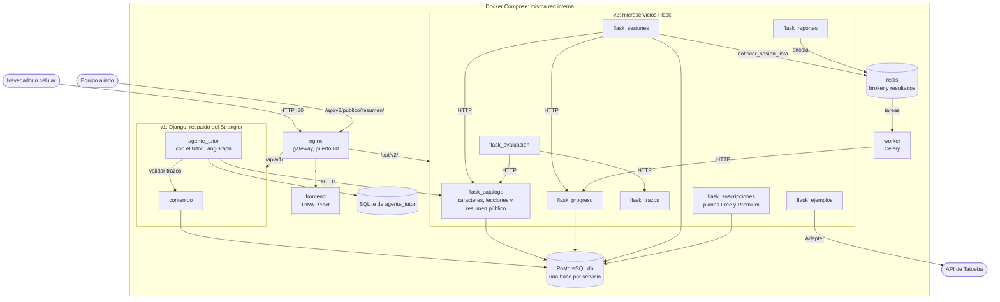
 
Las bases de los servicios Flask son `db_catalogo`, `db_progreso`,
`db_sesiones` y `db_suscripciones`, en el mismo servidor PostgreSQL que la de `contenido`.
`flask_trazos`, `flask_evaluacion` y `flask_ejemplos` no guardan estado.
 
### Despliegue en AWS
 
La app está desplegada en **http://52.44.136.85/**, desde la rama `main`
(commit `e3425c3`).
 
- Instancia EC2 t3.medium, Ubuntu 24.04, región us-east-1, disco de 30 GB gp3.
- Security group: puerto 80 (HTTP) abierto; puerto 22 (SSH) solo desde una IP.
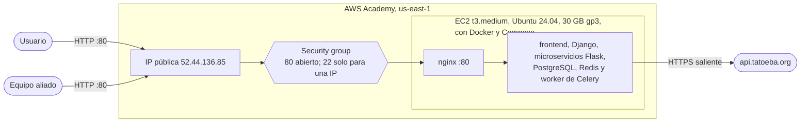
 
Pasos en la instancia, con Docker y Docker Compose instalados:
 
1. Clonar `main`: `git clone https://github.com/jalvarez01/HanZi-Mentor.git`.
2. Crear el `.env` desde `.env.example` y cambiar estas variables (los
   valores no se publican):
   - `DJANGO_DEBUG=0`;
   - `ALLOWED_HOSTS`: la IP pública, más `localhost,contenido,agente_tutor`;
   - `CONTENIDO_SECRET_KEY` y `TUTOR_SECRET_KEY`: una clave nueva para cada
     una, obligatorias con `DJANGO_DEBUG=0`;
   - `POSTGRES_PASSWORD`: una contraseña nueva;
   - `TATOEBA_TIMEOUT=8` (el ejemplo trae 3).
3. `docker compose up -d --build`.
**Limitación sin HTTPS.** La app se sirve por HTTP en la IP, que no es un
contexto seguro: el navegador no registra el service worker, así que la PWA
no se instala ni funciona sin conexión. El resto funciona igual; el UUID del
estudiante se genera con `crypto.getRandomValues`, que sí existe sin HTTPS.
 
#### Evidencia
 
La app abierta en el navegador con la IP pública en la barra de dirección:
 
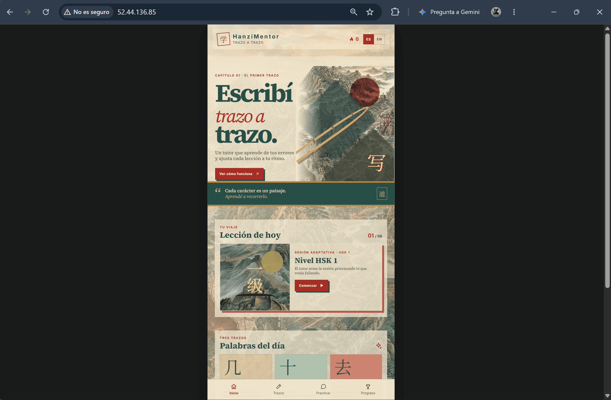
 
El recorrido lo hace
[`tools/auditoria-ux/despliegue.mjs`](https://github.com/jalvarez01/HanZi-Mentor/blob/main/tools/auditoria-ux/despliegue.mjs)
contra la IP pública, con un usuario nuevo creado por la app: Inicio sin
errores en la consola, dos sesiones de Práctica, Trazos con oraciones de
Tatoeba, patrones de error y repasos en Progreso, el reporte asíncrono, el
cambio a inglés y Premium con la tarjeta de prueba. axe-core (WCAG 2.1 AA) a
375 px no encontró violaciones en ninguna pantalla. El resultado de cada paso
está en
[`resumen.json`](https://github.com/jalvarez01/HanZi-Mentor/blob/main/tools/auditoria-ux/reportes/despliegue/resumen.json)
y el estado de los contenedores y las respuestas de la API en
[`infra.txt`](https://github.com/jalvarez01/HanZi-Mentor/blob/main/tools/auditoria-ux/reportes/despliegue/infra.txt).
 
Fin de la segunda sesión, con el desempeño y el patrón principal:
 
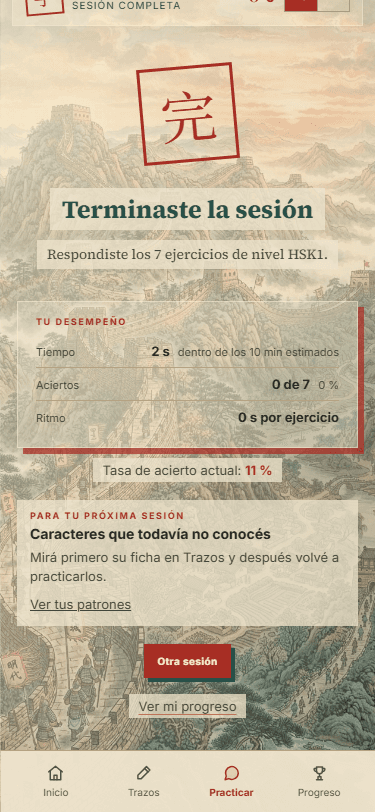
 
Progreso con los patrones de error de las dos sesiones:
 
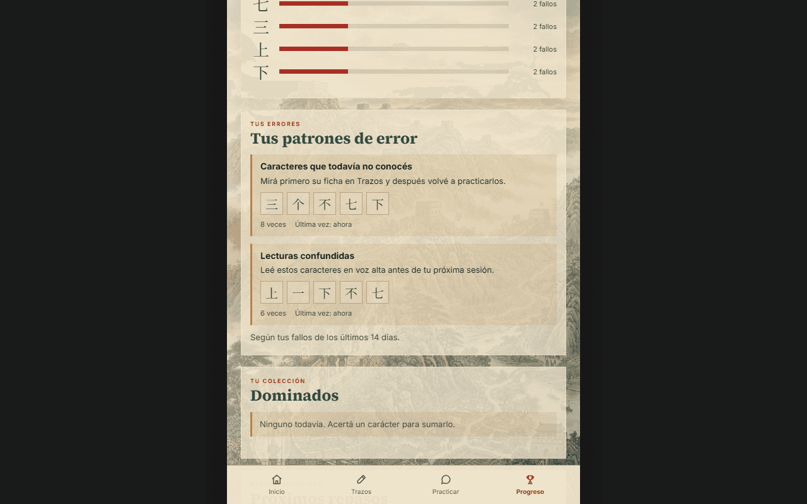
 
Trazos con las oraciones de Tatoeba que entrega `flask_ejemplos`:
 
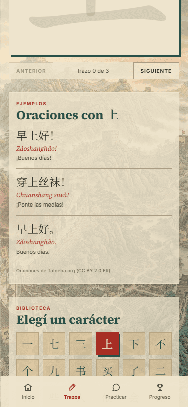
 
### Secuencia: crear una sesión adaptativa
 
Es la versión actualizada del diagrama de la Entrega 1. Antes todo pasaba
dentro de `agente-tutor`; ahora `flask_sesiones` pide el progreso y los
caracteres a otros servicios por HTTP, guarda la sesión en su propia base y
avisa por Redis que está lista.
 
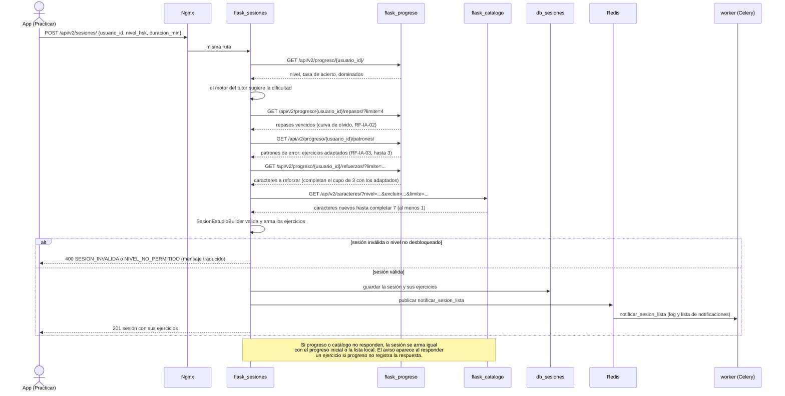
 
### API de terceros con el patrón Adapter
 
El caso de uso solo conoce la interfaz `ProveedorEjemplos`. La fábrica
decide qué adaptador usar según la variable `PROVEEDOR_EJEMPLOS`, así que
cambiar de proveedor no toca el caso de uso (inversión de dependencias).
 
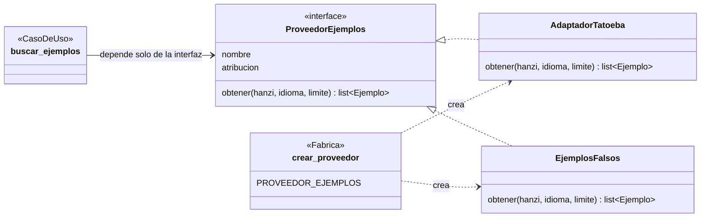
 
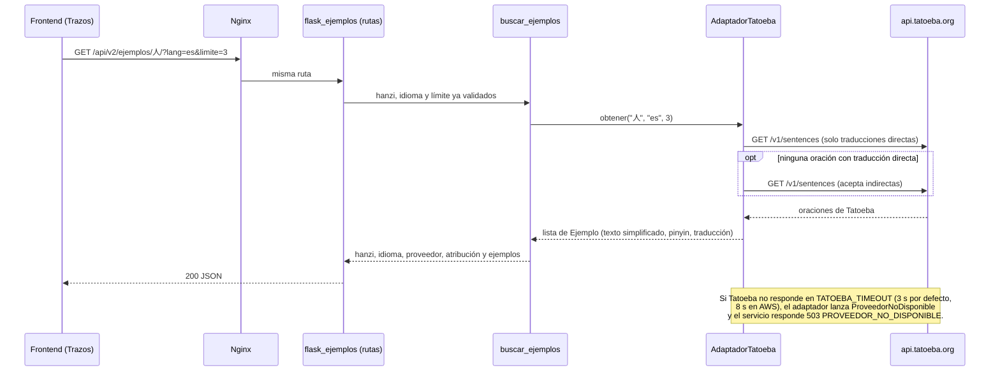
 
El mismo patrón se usa para los pagos de Premium (RF-USR-01):
`suscripciones-flask` solo conoce el puerto `PasarelaPago` y la variable
`PASARELA_PAGO` elige el adaptador. Hoy el único es `PasarelaSimulada`, que
no mueve dinero; una pasarela real sería otro adaptador, sin tocar el caso
de uso. Detalle en el
[README del servicio](https://github.com/jalvarez01/HanZi-Mentor/blob/main/services/suscripciones-flask/README.md).
 
### Secuencia: tarea asíncrona (reporte de progreso)
 
El reporte no se calcula en la petición: `flask_reportes` lo encola en
Redis, el worker de Celery lo genera y el frontend consulta su estado.
 
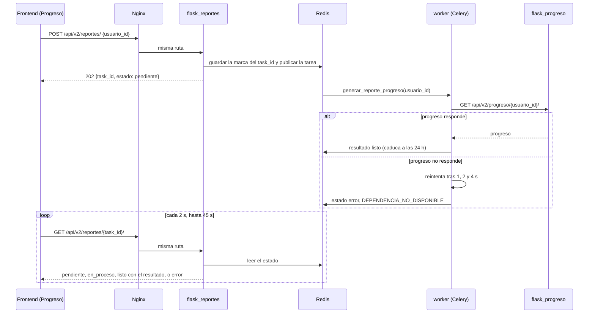
 
### Secuencia: servicio para el equipo aliado
 
El equipo aliado consume el resumen público de `flask_catalogo`. El consumo
del servicio del aliado desde HanZi Mentor (T26) se agrega cuando se acuerde
el contrato (T03).
 
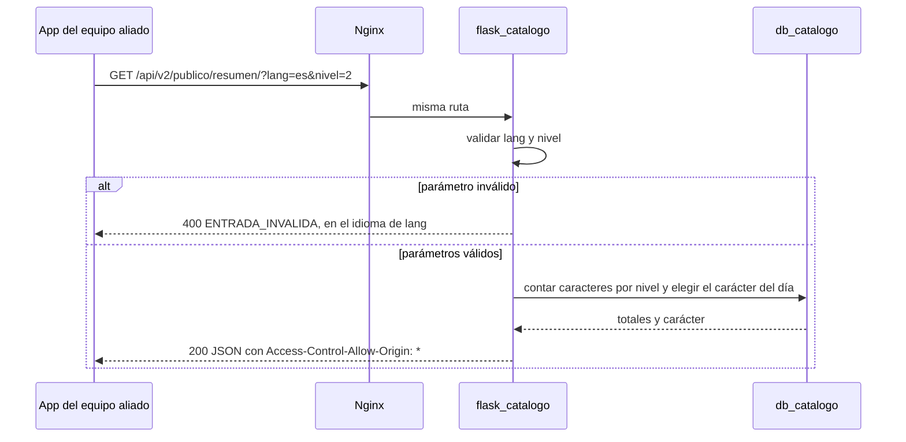
 
