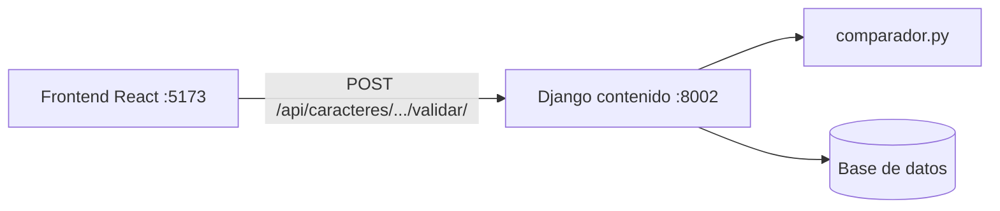
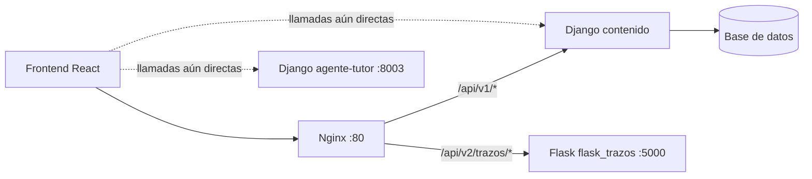

# Migración a Microservicios (Strangler Pattern)

## Resumen

HanziMentor extrajo la validación de trazos del servicio Django `contenido` y la trasladó a un microservicio Flask independiente (`flask_trazos`), publicado detrás de Nginx en `/api/v2/trazos/validar/`. Para ello se aplicó el Patrón Estrangulador (Strangler Pattern), que permite migrar de forma gradual: la versión v1 (Django) y la versión v2 (Flask) coexisten, Nginx elige el destino según el prefijo de la URL y, en consecuencia, el usuario no percibe el cambio.

## Módulo estrangulado

El módulo elegido fue la validación de trazos. La siguiente tabla compara su ubicación antes y después de la migración.

| Elemento | Antes (v1) | Después (v2) |
|----------|-----------|--------------|
| Módulo | Validación de trazos | Validación de trazos |
| Servicio | Django `contenido` | Flask `flask_trazos` |
| Endpoint | `POST /api/caracteres/<hanzi>/trazos/<secuencia>/validar/` | `POST /api/v2/trazos/validar/` |
| Lógica | `services/contenido/caracteres/domain/comparador.py` | `services/trazos-flask/comparador.py` |

## Matriz de decisión

Para llegar a esa elección se evaluaron cuatro módulos candidatos en una escala de 1 a 5, con los criterios definidos en el taller.

| Módulo | Frecuencia de cambio | Consumo de recursos (CPU) | Acoplamiento con la base de datos | Puntaje | Decisión |
|--------|:-:|:-:|:-:|:-:|----------|
| Usuarios / Progreso | 2 (Baja) | 2 (Baja) | 5 (Muy alta) | 5 | Mantener en Django |
| Catálogo de caracteres | 2 (Baja) | 2 (Baja) | 3 (Media) | 7 | Mantener en Django |
| Sesiones del tutor | 4 (Alta) | 3 (Media) | 4 (Alta) | 9 | Mantener en Django |
| **Validación de trazos** | **3 (Media)** | **5 (Muy alta)** | **1 (Muy baja)** | **13** | **Estrangular (Flask)** |

El puntaje se calcula como `Puntaje = Frecuencia + Recursos + (6 − Acoplamiento)`. El acoplamiento se invierte para que reste, porque cuantas más tablas comparte un módulo, más costoso y riesgoso resulta separarlo. Las calificaciones de cada módulo se explican así:

- **Usuarios / Progreso:** cambia poco, consume poca CPU y depende fuertemente de los modelos y relaciones del ORM.
- **Catálogo de caracteres:** contenido estable de solo lectura, pero ligado a las tablas de caracteres y trazos.
- **Sesiones del tutor:** evoluciona con frecuencia, pero orquesta sesiones, ejercicios y progreso persistidos en su propia base de datos.
- **Validación de trazos:** el algoritmo se ajusta con regularidad, es el proceso más intensivo en CPU y solo necesita la mediana y los puntos dibujados.

## Justificación

La matriz señala a la validación de trazos como el candidato más claro, y tres características del módulo explican ese resultado. En primer lugar, es una función pura sin dependencias de Django: `comparar_trazo(puntos_usuario, mediana, ancho_lienzo, alto_lienzo)` devuelve un `ResultadoComparacion` sin usar ORM, vistas ni configuración de Django, por lo que se extrajo casi sin reescribir.

Además, es el proceso más intensivo en CPU del sistema. Suaviza, remuestrea y compara el trazo en ambos sentidos, y se invoca en cada trazo que dibuja el usuario; por esta razón, dentro de Django puede bloquear workers que atienden el resto de peticiones. Finalmente, su acoplamiento es bajo, ya que solo necesita la mediana del trazo y los puntos dibujados y no consulta otras tablas.

## Arquitectura

Una vez elegido el módulo, los siguientes diagramas muestran cómo cambia el recorrido de una validación.

### Antes

Toda la validación ocurría dentro de Django `contenido`.



### Después

Nginx actúa como punto de entrada y reparte las peticiones según el prefijo. Las líneas punteadas indican las llamadas que todavía no pasan por él.



## Separación técnica

La separación que muestran los diagramas se apoyó en cuatro piezas: el microservicio Flask, su contenedorización, el ruteo en Nginx y la adaptación del frontend.

### Microservicio Flask

El servicio vive en `services/trazos-flask/` y expone `POST /api/v2/trazos/validar/`, que recibe y responde JSON. Su código se reparte en módulos con una responsabilidad cada uno: `app.py` (fábrica `create_app()` y `/health`), `rutas.py` (controlador), `validacion.py` (forma de la entrada), `servicio.py` (caso de uso), `comparador.py` (dominio puro) y `errores.py` (manejadores globales). El servicio no importa ningún módulo de Django, y `comparador.py` es una copia del dominio de `services/contenido/caracteres/domain/comparador.py`.

Los errores siguen una forma estructurada: toda respuesta de error es JSON con `error` y `codigo`. Así, una entrada fuera de contrato devuelve 400 `ENTRADA_INVALIDA` y una falla inesperada devuelve 500 `ERROR_INTERNO` sin exponer el stack trace. Además, `GET /health` responde 200. Las pruebas con pytest (`tests/test_api.py`) cubren trazo correcto, trazo invertido, puntos como objetos `{"x","y"}`, JSON mal formado, campos faltantes, coordenadas no numéricas, dimensiones inválidas, 404, 405 y 500.

### Contenedorización

Para desplegarse por separado, Flask cuenta con un Dockerfile independiente: una imagen `python:3.11-slim` que ejecuta gunicorn en el puerto 5000 (`gunicorn -b 0.0.0.0:5000 "app:create_app()"`). El archivo `docker-compose.yml` reúne 4 servicios: Django `contenido`, Flask `flask_trazos`, base de datos y Nginx. De ellos, solo Nginx publica un puerto en el host (`80:80`), de modo que Django y Flask solo son accesibles dentro de la red de Docker.

### Solución arquitectónica (snippet Nginx)

Dentro de esa red, Nginx decide el backend a partir del prefijo de la URL: `/api/v1/` va a Django y `/api/v2/trazos/` va a Flask.

```nginx
upstream contenido {
    server contenido:8002;
}

upstream flask_trazos {
    server flask_trazos:5000;
}

server {
    listen 80;

    proxy_set_header Host $host;
    proxy_set_header X-Real-IP $remote_addr;
    proxy_set_header X-Forwarded-For $proxy_add_x_forwarded_for;

    # v1: Django. Reescribe /api/v1/... a /api/...
    location /api/v1/ {
        proxy_pass http://contenido/api/;
    }

    # v2: Flask. Conserva la ruta completa.
    location /api/v2/trazos/ {
        proxy_pass http://flask_trazos;
    }
}
```

El prefijo se reescribe porque las rutas de Django se declaran bajo `/api/` (`config/urls.py`) y no bajo `/api/v1/`. Al terminar `proxy_pass` con la URI `/api/`, Nginx reemplaza el prefijo `/api/v1/` por `/api/`; de este modo, la API pública queda versionada sin modificar el código de Django. En cambio, en `/api/v2/trazos/` `proxy_pass` no lleva URI y Flask recibe la ruta tal cual, porque ya declara `/api/v2/trazos/validar/`.

### Frontend

El último paso fue apuntar el frontend al nuevo servicio. La función `validarTrazo` de `frontend/src/services/api.js` llama ahora a `POST ${TRAZOS_URL}/api/v2/trazos/validar/`, donde `TRAZOS_URL` sale de `VITE_TRAZOS_URL` y por defecto es `""` (mismo origen); ya no se usa `CONTENIDO_URL`. Su firma pasó a ser `validarTrazo({ mediana, puntos, ancho, alto })`, sin `hanzi` ni `secuencia`, porque v2 no los necesita. Como Flask no consulta la base de datos, la vista de trazos (`frontend/src/pages/Trazos.jsx`) envía `trazoActual.mediana`, ya cargada con el detalle del carácter, sin una petición adicional. Los puntos se envían como objetos `{x, y}`, y Flask acepta tanto `{x, y}` como `[x, y]`.

El acceso al servicio depende del entorno. En desarrollo, Vite redirige `/api/v2` hacia `VITE_GATEWAY_URL` (por defecto `http://localhost:80`, Nginx), lo que evita problemas de CORS desde `:5173`. En producción, sin embargo, no existe el proxy de Vite: el frontend debe servirse detrás del mismo Nginx, o bien `VITE_TRAZOS_URL` debe apuntar al gateway. Ambas variables están documentadas en `frontend/.env.example`.

En cuanto a los errores, la interfaz muestra el mensaje junto a su código (por ejemplo, `Faltan campos: alto (ENTRADA_INVALIDA)`). Si el cuerpo del error no es JSON, como ocurre con una página HTML 502 de Nginx, se muestra `Error <status>`.

Por último, el alcance de este cambio es parcial: por ahora solo la validación de trazos (`/api/v2`) pasa por Nginx, mientras que caracteres, lecciones y el tutor siguen llamando directamente a `contenido` (`:8002`) y a `agente-tutor` (`:8003`).

## Contrato de la API

El intercambio entre el frontend y Flask queda fijado por el siguiente contrato.

### `POST /api/v2/trazos/validar/`

**Cuerpo de la petición**

```json
{"mediana": [[x,y],...], "puntos": [[x,y],...], "ancho": 300, "alto": 300}
```

| Campo | Tipo | Descripción |
|-------|------|-------------|
| `mediana` | lista de `[x, y]` | Mediana oficial del trazo esperado. |
| `puntos` | lista de `[x, y]` o de `{"x": .., "y": ..}` | Puntos dibujados por el usuario; se acepta el formato de objetos que envía el frontend actual. |
| `ancho` | entero positivo | Ancho del lienzo donde se dibujó. |
| `alto` | entero positivo | Alto del lienzo donde se dibujó. |

**Respuestas**

| Código | Cuerpo | Cuándo |
|--------|--------|--------|
| 200 | `{"aprobado": true, "puntaje": 95, "motivo": "correcto", "detalle": "..."}` | La entrada es válida y el trazo fue evaluado. |
| 400 | `{"error": "...", "codigo": "ENTRADA_INVALIDA"}` | JSON mal formado o fuera de contrato. |
| 500 | `{"error": "Error interno", "codigo": "ERROR_INTERNO"}` | Error inesperado del servidor. |

**Campos de la respuesta 200**

| Campo | Tipo | Descripción |
|-------|------|-------------|
| `aprobado` | booleano | Indica si el trazo fue aceptado. |
| `puntaje` | entero (0 a 100) | Calificación del trazo. |
| `motivo` | texto | Resultado de la evaluación (ver valores abajo). |
| `detalle` | texto | Mensaje legible para el usuario. |
| `invertido` | booleano | Indica si el trazo se dibujó en sentido contrario al esperado. |
| `puntos_lejanos` | lista de objetos `{"posicion": .., "desvio": ..}` | Hasta 3 tramos donde el trazo del usuario quedó lejos de la mediana; `posicion` es la fracción del recorrido (0 a 1) y `desvio` la distancia relativa. Lista vacía si no hay desvíos relevantes. |

**Valores de `motivo`**

| Valor | Significado |
|-------|-------------|
| `correcto` | El trazo coincide con la mediana. |
| `invertido` | El trazo se dibujó en sentido contrario. |
| `impreciso` | La forma se aleja demasiado de la mediana. |
| `incompleto` | La longitud del trazo es demasiado corta o demasiado larga respecto a la esperada. |
| `vacio` | El trazo o la mediana tienen menos de 2 puntos. |

### `GET /health`

| Código | Cuerpo |
|--------|--------|
| 200 | `{"estado": "ok", "servicio": "trazos-flask"}` |

## Impacto esperado

Con la separación en marcha, la migración aporta beneficios concretos, aunque también introduce costos que se asumieron de forma consciente.

El principal beneficio es que la carga de CPU queda aislada: la comparación de trazos ya no consume workers de Django. Además, el servicio escala y se despliega de forma independiente, ya que se pueden añadir réplicas de Flask sin escalar Django y un cambio en el algoritmo no exige redesplegar `contenido`. A esto se suma un ciclo de cambio más rápido, porque el algoritmo vive en un servicio pequeño con pruebas propias. Los fallos también quedan aislados: una caída de Flask no afecta al catálogo, las lecciones ni los usuarios.

Sin embargo, la separación tiene un precio. Cada petición atraviesa Nginx antes de llegar al backend, lo que añade un salto de red. Por otra parte, el comparador queda duplicado temporalmente en `contenido` y en Flask hasta retirar v1, y ahora hay dos servicios que desplegar, monitorear y versionar.

En consecuencia, la migración todavía no está terminada. Por ahora solo la validación de trazos (`/api/v2`) pasa por Nginx: caracteres, lecciones y el tutor siguen llamando directamente a `contenido` (`:8002`) y a `agente-tutor` (`:8003`), y el siguiente paso del Strangler Pattern es moverlas detrás de Nginx `/api/v1/`. Del mismo modo, `tutor/infra/catalogo.py` de `agente-tutor` todavía consume el endpoint de validación v1 de `contenido`; se migrará a v2 en una etapa posterior, tras lo cual podrá retirarse el comparador de Django.

## Verificación

Para comprobar que el ruteo funciona como se describe, los siguientes comandos se ejecutan desde la raíz del repositorio.

1. Construir y levantar los contenedores:

```bash
docker compose up -d --build
```

2. Confirmar que los 4 servicios están en ejecución y que solo Nginx publica el puerto 80:

```bash
docker compose ps
```

3. Ruta v1 (Django). Esperado: 200 con la lista de caracteres:

```bash
curl -i "http://localhost/api/v1/caracteres/?nivel=1&limite=5"
```

4. Ruta v2 (Flask) con cuerpo válido. Esperado: 200 con `aprobado`, `puntaje`, `motivo` y `detalle`:

```bash
curl -i -X POST http://localhost/api/v2/trazos/validar/ \
  -H "Content-Type: application/json" \
  -d '{"mediana": [[458,800],[435,764],[400,700],[350,620],[300,540]],
       "puntos":  [[134,29],[127,40],[117,59],[103,82],[88,105]],
       "ancho": 300, "alto": 300}'
```

5. Ruta v2 con cuerpo inválido (falta `alto`). Esperado: 400 con `"codigo": "ENTRADA_INVALIDA"`:

```bash
curl -i -X POST http://localhost/api/v2/trazos/validar/ \
  -H "Content-Type: application/json" \
  -d '{"mediana": [[0,0],[1,1]], "puntos": [[0,0],[1,1]], "ancho": 300}'
```

6. Confirmar en los logs que cada petición llegó a su backend:

```bash
docker compose logs nginx
docker compose logs flask_trazos
```

Las peticiones `/api/v1/` aparecen en el log de Nginx y en el de `contenido`; las `/api/v2/trazos/` aparecen en el de Nginx y en el de `flask_trazos`.

## Equipo y Git Flow

El trabajo se repartió entre tres integrantes, cada uno en su propia rama.

| Integrante | Responsabilidad | Rama |
|------------|-----------------|------|
| Juan José Álvarez | Microservicio Flask | `feature/flask-trazos` |
| Santiago Meneses | Docker y Nginx | `feature/docker-nginx` |
| Emmanuel Castaño | Matriz de decisión, wiki e integración del frontend | `docs/strangler-wiki` |

La integración se realiza mediante Pull Requests revisados hacia `development` y commits semánticos (`feat`, `fix`, `docs`, `test`, `chore`).
